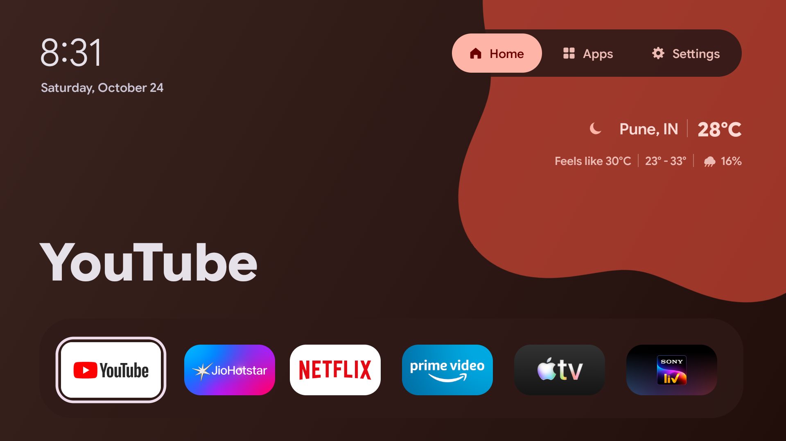

# CleanFire Launcher

A customizable, Material-inspired launcher for supported Fire TV devices. CleanFire Launcher is a Fire OS fork of [Material TV Launcher by 0xRampey](https://github.com/0xRampey/material-tv-launcher). It replaces recommendation-heavy Home content with a six-app dock, alphabetical app grid, and weather. It is independent of Amazon and the upstream developer.



Weather: [Open-Meteo](https://open-meteo.com/). Approximate IP location: [ipdata.co](https://ipdata.co/).

## Features

- Native Java Views with app-based dynamic colors, animated Material shapes, focus rings, and D-pad navigation.
- Six customizable Home shortcuts. Short Select launches an app; long Select opens Move/Replace. Move swaps adjacent slots with Left/Right, Select saves, and Back cancels. Replace opens an installed-app picker.
- An alphabetical Apps tab with names below tiles. Its tune button shows all installed launchable apps; hidden apps appear greyed out. Select toggles a tile's visibility. Tune, Back, or leaving the tab saves the change. Hiding an app in Apps does not remove its Home shortcut.
- A Settings side panel with Wi-Fi, Bluetooth, and All settings destinations. It shows connected network and audio-device names when Android makes them available.
- Keyless weather with approximate city detection, current and feels-like Celsius temperature, today's low/high, current-hour rain probability, and an offline cache.
- An optional Android screensaver component, never enabled automatically.

The earlier Preferences tab was removed. Home shortcut editing is now in the Home tile menu, and app visibility editing is behind the Apps tune button. Upstream Now Playing, HDMI switching, and Home-key service code are not active features of this Fire OS build.

## Supported devices

**Tested:** Fire TV Stick 4K, 2nd generation (2023), model AFTKM, Fire OS 8.1.8.5 (Android 11 / API 30). Other Fire OS 8 and Android TV devices may work but are unverified. The stock Amazon launcher remains installed.

## Install

Download an APK from this project's GitHub Releases page once published. Wireless ADB requires the computer and TV on the same network. Enable ADB debugging on the TV where the firmware permits it, accept its authorization prompt, then run:

```sh
adb connect FIRE_TV_IP:5555
adb install CleanFire-Launcher-v1.0.0.apk
adb shell am start -n dev.karat.materialhome/com.rampey.materialtv.HomeActivity
```

If connection is refused or there is no route to host, check the TV's address, network, and ADB setting. If installation succeeded but the launcher does not open, run the `am start` command again. `adb install -r` can update only an APK signed with the **same certificate**. A debug-signed development install cannot be updated in place by a differently signed public release. Uninstalling can erase preferences; back up your setup before changing signing identities. Neither the APK nor `install-fireos.sh` changes Home-button routing or system packages.

Fire OS normally keeps Amazon Home as the Home-button destination. [Home on Fire](https://github.com/toolicious/home-on-fire) is an optional, separate workaround whose compatibility varies by firmware. Configure it yourself if desired and keep Amazon Home for recovery. CleanFire Launcher does not bundle it or enable an accessibility service.

## Use the remote

Use the D-pad to focus a tab or tile and Select to open it. On Home, hold Select on an app tile for Move/Replace. In Move, Left/Right swaps a neighboring slot, Select saves, and Back restores the previous order. Replace lets you choose an installed app or press Back to cancel. On Apps, the tune icon beside “All apps” shows hidden and visible apps; Select toggles one. Back exits editing, saves, and stays on Apps. Back from the normal Apps view returns Home. Settings opens a side panel whose rows launch native Fire TV Settings.

The Apps grid discovers launcher/Leanback activities from installed packages. An app missing from the grid may be hidden: open Apps → tune to restore it. Apps without a compatible launch activity cannot appear. Home shortcuts are independent of Apps visibility.

## Weather and privacy

Weather uses [ipdata.free](https://ipdata.co/free) to infer city, country, coordinates, and timezone from the device's public IP. Coordinates and timezone go to [Open-Meteo](https://open-meteo.com/en/docs) for a forecast. No API key or Android location permission is used for weather. Approximate location is cached in app-private preferences for about 24 hours; forecasts refresh about every 15 minutes while Home is active. The last good response remains available offline, and provider failure leaves the launcher usable. VPNs, shared gateways, and ISP routing can make the city inaccurate.

The Settings panel may ask for optional foreground Android location permission solely to read the connected Wi-Fi name, which Fire OS otherwise redacts. Denial leaves an unavailable label. The app queries launchable packages and may use user-granted usage access for ordering; it does not transmit app lists, device identifiers, or analytics. The current fork's only network calls are the two weather requests above. [ipdata.free's keyless tier](https://ipdata.co/free) allows 1,000 requests per calling public IP daily, shared by devices behind it, and requires visible attribution. [Open-Meteo's free API terms](https://open-meteo.com/en/terms) allow non-commercial use with attribution and rate limits. Commercial distribution would require an appropriate Open-Meteo plan or another provider.

## Build from source

Use JDK 17+, Android SDK platform 30, and Build Tools 35.0.0 on macOS or Linux. Clone your public fork, set `ANDROID_HOME` if needed, then:

```sh
./build.sh --debug
# build/material-home-fireos.apk, signed with the local Android debug key
```

`./build.sh` without an option is the same debug build. Release builds require a persistent keystore and signing values; the script never creates a release identity implicitly:

```sh
export RELEASE_KEYSTORE=/secure/path/cleanfire-release.jks
export RELEASE_KEY_ALIAS=cleanfire
printf 'Release keystore password: '
read -rs RELEASE_KEYSTORE_PASS
printf '\n'
export RELEASE_KEYSTORE_PASS
./build.sh --release
# build/cleanfire-release.apk
```

Set `RELEASE_KEY_PASS` if the private-key password differs. Keep the keystore and passwords outside the repository and back them up securely for all future updates. To create your own identity once, run `keytool -genkeypair -keystore /secure/path/cleanfire-release.jks -alias cleanfire -keyalg RSA -keysize 3072 -validity 10000` and let it prompt for passwords. Verify with `$ANDROID_HOME/build-tools/35.0.0/apksigner verify --verbose --print-certs build/cleanfire-release.apk`. Release mode drops Java debug information and uses D8 release mode; it does not minify or obfuscate classes.

Version 1.0.0 uses versionCode 184. The ID remains `dev.karat.materialhome` for upgrades and preference continuity when the certificate matches. See [FIREOS_PORTING.md](FIREOS_PORTING.md), [DEVELOPMENT_LOG.md](DEVELOPMENT_LOG.md), and [RELEASE_CHECKLIST.md](RELEASE_CHECKLIST.md).

## Troubleshooting

- **Weather unavailable or wrong city:** check network access, wait for a retry, and consider a VPN or ISP gateway. Cached readings may be stale offline.
- **Home opens Amazon Home:** configure Home on Fire separately if it supports your firmware; direct ADB launch still works.
- **App missing from Apps:** open Apps → tune and unhide it; otherwise check for a launchable activity.
- **Signature mismatch or failed update:** the installed APK uses a different certificate. Review the data-loss warning above before removing anything.
- **Old Fire TV library artwork:** Fire OS may cache an app's name/icon after an update. App Details shows Android's current metadata. A data-preserving `pm uninstall -k` / reinstall refreshed the test device's library, but can affect integrations and should not be done casually.

## Credits and license

CleanFire Launcher is based on [Material TV Launcher](https://github.com/0xRampey/material-tv-launcher) by 0xRampey and contributors. Weather data is from [Open-Meteo](https://open-meteo.com/); IP location is from [ipdata.co](https://ipdata.co/). Bundled [material-color-utilities](https://github.com/material-foundation/material-color-utilities) is Apache 2.0 and [Google Sans Flex](https://github.com/googlefonts/googlesans-flex) is SIL Open Font License 1.1. See [NOTICE](NOTICE), [LICENSE](LICENSE), and bundled dependency notices. This fork is Apache 2.0; no Amazon, Google, or upstream endorsement is implied.
